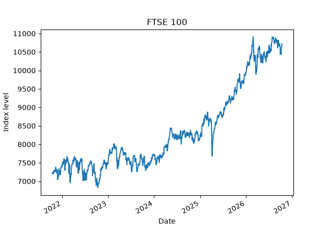
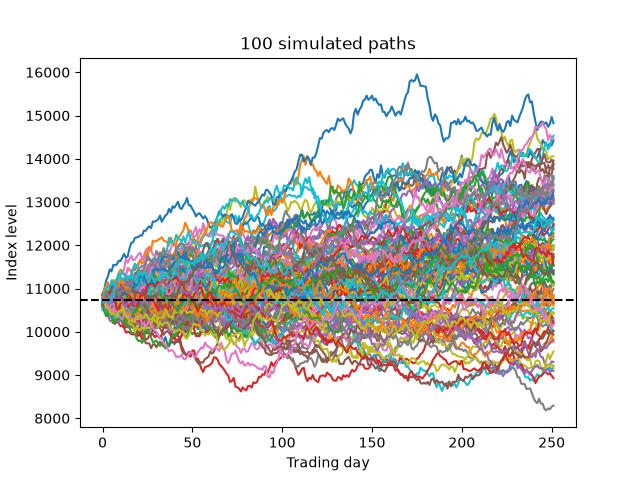
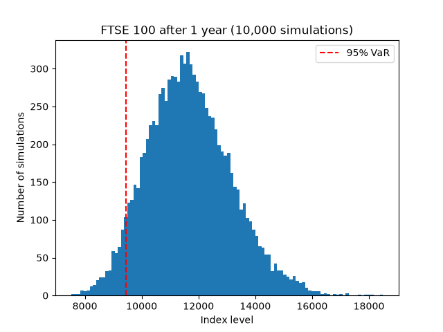

# FTSE 100 Monte Carlo Simulation
I'm a first year Maths, Statistics and Data Science student at the University of Birmingham. I made this project to learn how Monte Carlo simulation is used in finance to measure risk.

## How it works
1. Downloads 5 years of daily FTSE 100 closing prices (Oct 2021 – Oct 2026) using yfinance
2. Calculates daily log returns, then their average return and the volatility
3. Simulates 10,000 possible one-year paths, assuming returns are normally distributed
4. Measures risk using 95% Value at Risk (VaR) and Expected Shortfall (ES)

## Results
- Annual return (historical): 7.88% 
- Annual volatility: 12.57%
- Chance of a loss after 1 year: 26.8%
- 95% one-year VaR: 12.0% 
- 95% one-year Expected Shortfall: 16.5% 

In 1 year out of 20, the FTSE 100 could be expected to fall by more than 12%. In those bad years, the average loss is about 16.5%.

## Limitations
- The model assumes returns are normally distributed, but real markets have more extreme crashes than this predicts
- The drift is based on a strong 5-year period, so the results may be too optimistic
- Volatility is assumed to stay constant, which doesn't happen in real life

## Libraries used
numpy, matplotlib, yfinance
